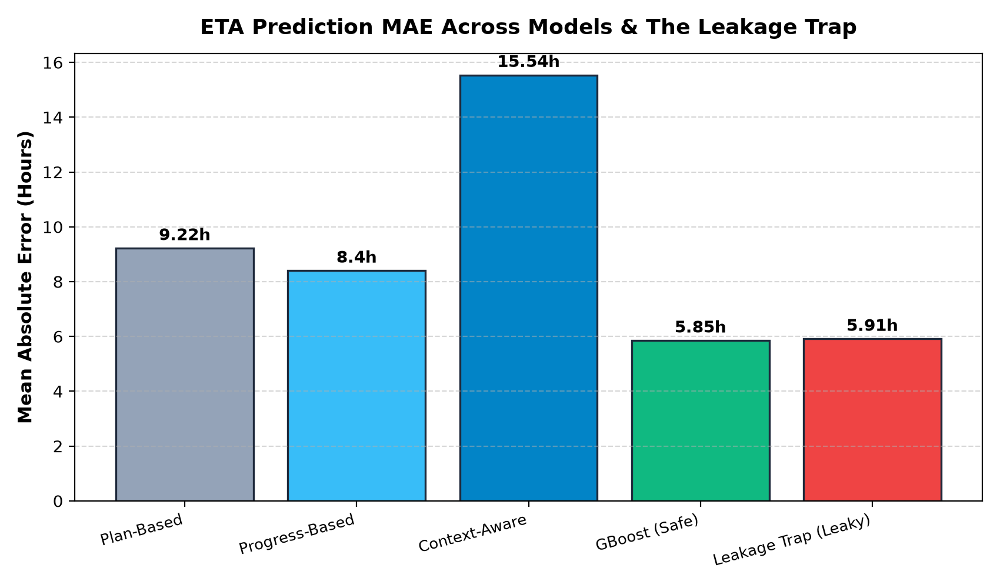
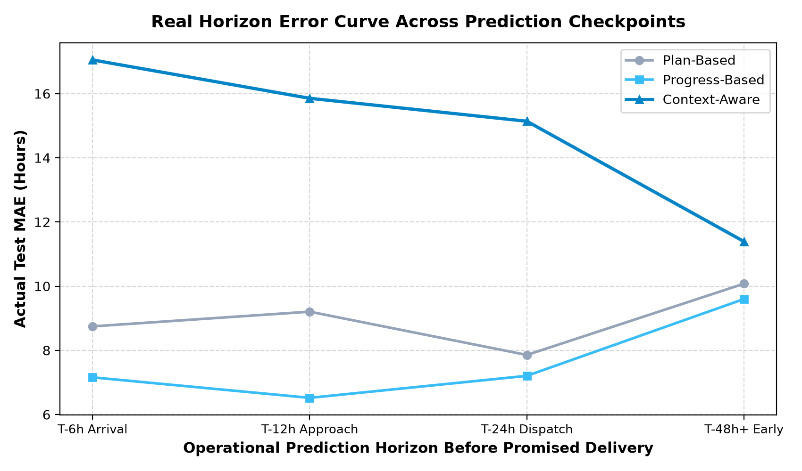

# Model Evaluation: ETA Prediction & Delay Classification

This evaluation uses a **shipment-grouped chronological split**. All snapshots from a shipment are kept in one partition, and shipment cohorts are ordered by their first prediction timestamp.

The route-change feature is point-in-time: a recorded route change is included only when its `effective_time` is at or before the prediction timestamp. The route-change CSV does not provide a separate ingestion timestamp, so this evaluation assumes the change is available at its effective time.

---

## 1. Primary Benchmark Results

| Model / Baseline | MAE (h) | P90 Error (h) | Bias (h) | Delay F1 | Precision | Recall | ROC-AUC |
|---|---:|---:|---:|---:|---:|---:|---:|
| Plan Based | 9.22 | 19.14 | -9.01 | 0.063 | 0.97 | 0.032 | 0.536 |
| Progress Based | 8.4 | 18.84 | -4.34 | 0.39 | 0.601 | 0.289 | 0.614 |
| Context Aware | 15.54 | 28.97 | 12.97 | 0.616 | 0.453 | 0.962 | 0.553 |
| Ml Gradient Boost | 5.85 | 11.09 | -0.41 | 0.634 | 0.469 | 0.979 | 0.642 |
| Leakage Trap (`event_time` peek) | 5.91 | 11.05 | -0.45 | 0.423 | 0.64 | 0.315 | 0.644 |

---

## 2. Key Findings

### Baseline and ML Performance
- Plan-Based MAE: **9.22h**.
- Progress-Based MAE: **8.4h**.
- Context-Aware MAE: **15.54h**, Delay ROC-AUC: **0.553**.
- Leakage-safe Gradient Boosting MAE: **5.85h**, ROC-AUC: **0.642**.

### Event-Time Leakage Comparison
- Physical events can occur before they are ingested into the system. A prediction made before ingestion must not use that event.
- The safe model filters events using `ingestion_time <= prediction_time`.
- The deliberately leaky comparison filters events using `event_time <= prediction_time`, which can expose events that were not yet available to the prediction system.
- Leakage-trap MAE: **5.91h**, ROC-AUC: **0.644**. The measured difference is dataset-dependent; leakage does not guarantee a particular metric improvement.

---

## 3. Classification Threshold Tuning

- Threshold selected on validation data: **0.30**.
- Validation F1: **0.664**, precision: **0.506**, recall: **0.965**.
- The final test shipment cohort was not used to select the threshold.

| Threshold | Validation Precision | Validation Recall | Validation F1 |
|---:|---:|---:|---:|
| 0.10 | 0.491 | 0.999 | 0.658 |
| 0.15 | 0.493 | 0.997 | 0.659 |
| 0.20 | 0.496 | 0.992 | 0.661 |
| 0.25 | 0.500 | 0.984 | 0.663 |
| 0.30 | 0.506 | 0.965 | 0.664 |
| 0.35 | 0.514 | 0.918 | 0.659 |
| 0.40 | 0.531 | 0.823 | 0.645 |
| 0.45 | 0.562 | 0.578 | 0.570 |
| 0.50 | 0.650 | 0.293 | 0.404 |
| 0.55 | 0.678 | 0.218 | 0.330 |
| 0.60 | 0.739 | 0.135 | 0.228 |
| 0.65 | 0.800 | 0.083 | 0.151 |
| 0.70 | 0.846 | 0.063 | 0.118 |
| 0.75 | 0.873 | 0.052 | 0.098 |
| 0.80 | 0.954 | 0.028 | 0.055 |
| 0.85 | 0.975 | 0.021 | 0.041 |
| 0.90 | 0.982 | 0.016 | 0.031 |

## 4. Class-Weighting Experiment

The unweighted and class-balanced classifiers use identical shipment-grouped fit, validation, and test partitions. Each classifier selects its own threshold using validation F1. Inverse-frequency sample weights are applied only during fitting; the final test cohort is not used for model or threshold selection.

| Classifier | Validation threshold | Validation F1 | Test precision | Test recall | Test F1 | Test PR-AUC | Test ROC-AUC |
|---|---:|---:|---:|---:|---:|---:|---:|
| Unweighted | 0.30 | 0.664 | 0.469 | 0.979 | 0.634 | 0.608 | 0.642 |
| Class-balanced | 0.30 | 0.664 | 0.469 | 0.979 | 0.635 | 0.608 | 0.642 |

## 5. Visualizations

